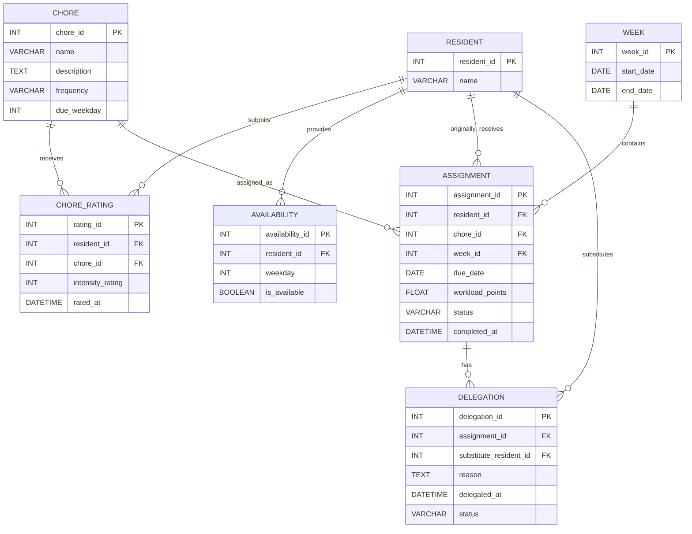

> Implementation update: MySQL setup is documented in README.md. Use Alembic migrations to create the schema. MySQL adds a generated `delegation.live_assignment_id` column for active-request uniqueness and an `app_write_lock` infrastructure table for transaction serialization. The seven domain entities below are unchanged. SQLite remains an optional fallback; existing SQLite data is not automatically transferred.

# Part 2: Database Design & Relational Schema

## 1. Entity-Relationship Diagram

Implement **seven physical entities** (`RESIDENT`, `CHORE`, `CHORE_RATING`, `WEEK`, `AVAILABILITY`, `ASSIGNMENT`, `DELEGATION`). Do not create extra physical entities (such as `WORKLOAD_HISTORY`, `CLASS_SCHEDULE`, or temporary unavailability tables) without a clear need.

---

## 2. Relational Implementation Details & Constraints

The Mermaid types above are conceptual; in actual SQLite migrations use appropriate SQLAlchemy types, lengths, `NOT NULL`, uniqueness, foreign keys, indexes, and `CHECK` constraints. Ensure SQLite foreign key enforcement (`PRAGMA foreign_keys = ON`) is active.

### 1. `RESIDENT`
- **Columns:** `resident_id` (PK), `name` (non-empty, e.g., `VARCHAR(100)`).
- **Presentation note:** The selected character, carousel position, viewport mode, and open/closed status panels are transient UI state, not resident attributes. Derive status from the seven existing entities. Use bundled avatar assets or a deterministic mapping with a fallback; do not add room, XP, level, achievement, or avatar fields solely to reproduce concept artwork.
- **Permitted Implementation Additions (for Auth & Fairness):** `username` (unique), `password_hash` (never store plaintext passwords), `is_active` (boolean), `joined_at` (timestamp). These support resident-only access and fair treatment of newcomers.

### 2. `CHORE`
- **Columns:** `chore_id` (PK), `name`, `description`, `frequency`, `due_weekday`.
- **Permitted Additions:** `is_active` (boolean) for retiring chores without deleting history.
- **Rules & Constraints:**
  - `due_weekday`: Integer `1` (Monday) through `7` (Sunday), used consistently across UI, database, and code.
  - `frequency`: For MVP, support `'weekly'` only (each active chore occurs once on its configured weekday each week). Validate this strictly.
  - **Prohibited:** Do **not** add an `estimated_minutes` field.

### 3. `CHORE_RATING`
- **Columns:** `rating_id` (PK), `resident_id` (FK), `chore_id` (FK), `intensity_rating` (integer `1..5`), `rated_at` (timestamp).
- **Rules & Constraints:**
  - **Unique Constraint:** `UNIQUE(resident_id, chore_id)` — one current rating per resident per chore. Residents may edit a rating (updating the row and `rated_at`).
  - **Check Constraint:** `intensity_rating` between `1` and `5`.
  - Ratings from active residents determine a chore's **collective workload score** (arithmetic mean). A chore with zero ratings is **not eligible for automatic generation**; do not silently invent a default score.

### 4. `WEEK`
- **Columns:** `week_id` (PK), `start_date` (Date, must be a Monday), `end_date` (Date, the following Sunday, exactly 6 days after `start_date`).
- **Rules & Constraints:**
  - **Unique Constraint:** `UNIQUE(start_date)`. Prevent duplicate or overlapping weeks through validation and constraints.
  - Monday–Sunday scheduling uses the **local `Asia/Manila` calendar**, not UTC weekdays.

### 5. `AVAILABILITY`
- **Columns:** `availability_id` (PK), `resident_id` (FK), `weekday` (integer `1..7`), `is_available` (boolean).
- **Rules & Constraints:**
  - **Unique Constraint:** `UNIQUE(resident_id, weekday)`.
  - Represents **recurring availability**, independent of `WEEK`, based on the resident's semester routine. Do **not** add `week_id`.
  - Missing days are treated as **not eligible** (unavailable) until explicitly set.
  - Whole-weekday granularity only for MVP (not hour-by-hour).

### 6. `ASSIGNMENT`
- **Columns:** `assignment_id` (PK), `resident_id` (FK — represents the **original resident**), `chore_id` (FK), `week_id` (FK), `due_date` (Date), `workload_points` (`FLOAT`), `status` (VARCHAR), `completed_at` (nullable timestamp).
- **Rules & Constraints:**
  - **Unique Constraint:** `UNIQUE(chore_id, week_id)` for weekly MVP so generating the same week twice never duplicates a chore.
  - **Point Snapshot:** Snapshot the chore's collective rating into `workload_points` at assignment generation time. Later rating edits must **not** retroactively change historical assignments.
  - **Status:** Allow only supported statuses such as `pending` and `completed` (add `in_progress` if used consistently). `completed_at` must be set **only** for completed work.
  - `due_date` must match the configured `due_weekday` within the referenced `WEEK`.

### 7. `DELEGATION`
- **Columns:** `delegation_id` (PK), `assignment_id` (FK), `substitute_resident_id` (FK), `reason` (TEXT), `delegated_at` (timestamp), `status` (`pending`, `accepted`, `rejected`, `cancelled`).
- **Rules & Constraints:**
  - Original assignee stays in `ASSIGNMENT.resident_id`. Never overwrite `ASSIGNMENT.resident_id` during delegation.
  - Allow delegation only for an **incomplete** assignment and to someone **other than the original assignee**, who is active and available on the chore's due weekday.
  - At most **one `pending` or `accepted` delegation per assignment** at a time. Enforce in transaction-safe application logic and, where practical, a partial unique index.
  - Preserve `rejected` and `cancelled` history.
  - An `accepted` delegation is final until completion (no chains of re-delegations in MVP). A new request after rejection or cancellation is allowed.

---

## 3. SQL Views & Reporting Queries

- Provide a SQL **view** or equivalent well-tested query for weekly workload reporting, plus cumulative and average statistics.
- **Do not create a physical `WORKLOAD_HISTORY` table.**
- Weekly totals must include residents with **zero** points (using appropriate outer joins/zero filling).
- Ignore weeks before a resident joined (`joined_at`) when calculating weekly averages.
