# Part 4: UI & User Workflows

> **Source Instructions:** Implement the following responsive UI and user journeys as Part 4 of the Dormie specification. Read Parts 1, 2, 3, and 5 before implementation. Connect screens to real backend services and persisted database records. Do not deliver static mockups as the application. Record implementation choices and limitations in `DECISIONS.md`.

> **Revision:** Consolidates the original seven-view Part 4 proposal with the subsequent Dormie welcome-screen and workflow mockups. Horizontal resident browsing is required on both devices. Mobile uses a vertically draggable status sheet; desktop uses a coverflow-inspired character carousel and click-to-open left/right status panels. This revision supersedes earlier desktop drag-up and permanent-sidebar concepts. The original seven-entity technical MVP remains the implementation baseline.

## 1. Design Identity and Scope

**Dormie.** — Automated chore delegation for happier dorm living.

Dormie is a mobile-first, local-first, single-dormitory web application with a gender-neutral pixel-art simulation-game aesthetic. Its primary purpose is fair, explainable chore allocation. Game-inspired visuals support engagement without replacing or distorting workload accounting.

### Visual direction

- Welcome screen: game title screen inspired by PewDiePie's Tuber Simulator, with original isometric pixel-art dorm scenery, residents studying and performing chores, the Dormie house logo, a large `START` button, and a resident icon in the upper-right corner.
- Application screens: warm cream background, olive-green primary actions, dark brown text, simple line icons, rounded cards, restrained shadows, and readable typography.
- Resident avatars: neutral casual clothing and varied appearances. Use original or appropriately licensed pixel-art assets; do not copy proprietary game assets.
- Use crisp pixel scaling for illustrations and standard readable UI fonts for body text and forms.
- Optional decorative sound/music controls appear only if functional; audio defaults off. Support reduced motion. Do not require sound or animation to use the app.

| Design token | Suggested value | Usage |
| --- | --- | --- |
| Canvas | `#FAF2E5` | Page background |
| Surface | `#F0E2C9` | Cards and inputs |
| Primary | `#58783D` | Buttons and active controls |
| Primary dark | `#364D3C` | Emphasis and focus outlines |
| Text | `#493426` | Headings and body text |
| Neutral | `#343832` | Secondary icons/text |
| Border | `#D6C8B0` | Separators and card outlines |
| Warning | `#8B5A1F` | Unassigned and pending warnings |
| Error | `#9D3333` | Validation and failed actions |

Use labels with all status colors. Ensure sufficient contrast, keyboard operability, visible focus, and accessible form labels. Use at least 44px interactive targets on touch screens. On desktop, retain the same information hierarchy with a landscape game-style stage, a compact top navigation bar, and two contextual side panels. Do not stretch the phone mockup or use a permanent dashboard sidebar.

### Core UX and responsiveness

- Preserve the original responsive web architecture (server-rendered templates such as Jinja2, lightweight JavaScript and CSS), Asia/Manila display timezone, status badges, validated forms, empty states, confirmations, and mobile-friendly tables.
- Treat the resident character carousel as the shared dashboard interaction model. On mobile, retain the bottom sheet and accessible expand/collapse controls. On desktop, open contextual side panels by clicking a character; no vertical drag is required or expected. Provide keyboard and pointer alternatives.

### Scope reconciliation with the visual concepts

The approved technical specifications in Parts 1–3 and 5 define the MVP. The mockups explore additional features, but do not authorize new tables or changes to the assignment algorithm.

- **Class schedule:** during first-time setup, ask residents to consult their fixed semester class schedule and translate it into recurring Monday–Sunday availability. The MVP stores only seven weekday booleans; no subject names, class times, timetable uploads, or hour-by-hour conflict checks. Section 14 documents the alternative if detailed class scheduling is intended as a revised requirement.
- **Registration:** use resident name, unique username, password, and confirmation (confirmation is UI-only). Room number, academic program, year level, and student ID from concept screens are not present in the current schema; omit rather than require them.
- **Completion:** self-report via `Mark as complete`; only the responsible resident is authorized. Photo evidence, QR verification, peer approval, and task-quality verification are not part of the MVP.
- **Gamification:** use decorative avatars and factual completion/progress displays. Persistent XP levels, streak rewards, rankings and achievements are optional future features, not requirements. Never use them as the allocation score.
- **Rules & Regulations:** include a read-only, static policy page; actual dorm policies require approval. No policy enforcement, fines, administrator role, or additional database entity.
- **Notifications:** use in-app pending delegation indicators derived from existing records. No external notification service or extra notification table.

---

## 2. Navigation and Screen Inventory

Keep the welcome screen outside the authenticated application shell. Use a hamburger menu and compact header on mobile; on desktop use a compact top navigation bar (Home, Chores & Ratings, My Availability, Weekly Assignments, Delegations, Statistics, Dorm Rules), with the signed-in account menu and in-app pending delegation indicator at the right. At intermediate widths, move overflowing links into an accessible menu. A mobile bottom navigation, if used, contains Home, Assignments, Chores, and Profile, with other pages accessible from the menu.

| ID | Screen / UI state | Primary action | Access |
| --- | --- | --- | --- |
| W01 | Welcome / title screen | START | Public |
| W02 | Create account / sign up | Create account | Public |
| W03 | Resident selection / login | Log in | Public |
| W04 | Recurring availability setup | Save and continue | Authenticated, onboarding |
| W05 | Initial chore intensity ratings | Save ratings | Authenticated, onboarding |
| W06 | Setup confirmation | Enter Dormie | Authenticated |
| D01 | Mobile dashboard (collapsed status sheet) | Swipe character horizontally / drag sheet up | Authenticated |
| D02 | Mobile dashboard (expanded status sheet) | Scroll details / drag sheet down | Authenticated |
| D03 | Resident browsing (either viewport) | Browse previous/next resident / return to me | Authenticated, read-only for other residents |
| D04 | Desktop dashboard (carousel only) | Select a character to view status | Authenticated |
| D05 | Desktop dashboard (two status panels open) | Browse characters / close panels / authorized chore actions | Authenticated |
| C01 | Chore catalog | Rate chore / add chore | Authenticated |
| C02 | Chore detail and rating editor | Save rating | Authenticated |
| C03 | Add / edit / retire chore | Save / confirm | Authenticated |
| A01 | Weekly assignments | Select week / assignment | Authenticated |
| A02 | Generate assignments | Generate / retry missing chores | Authenticated |
| A03 | Assignment detail and rationale | Mark as complete / delegate | Authenticated |
| A04 | Completion confirmation / success | Confirm completion | Current responsible resident |
| G01 | Request delegation | Choose substitute and send | Original assignee, eligible task |
| G02 | Delegation inbox / outbox | Review request | Authenticated |
| G03 | Incoming request detail | Accept / Reject | Target substitute |
| G04 | Pending / accepted / rejected / cancelled | Cancel / retry where allowed | Relevant resident |
| S01 | Statistics (personal / group) | Filter range and metric | Authenticated |
| R01 | Rules & Regulations | Expand category | Authenticated |
| P01 | My Profile | Update own settings / log out | Authenticated |
| P02 | Edit recurring availability | Save changes | Own profile |

### Overall navigation flow

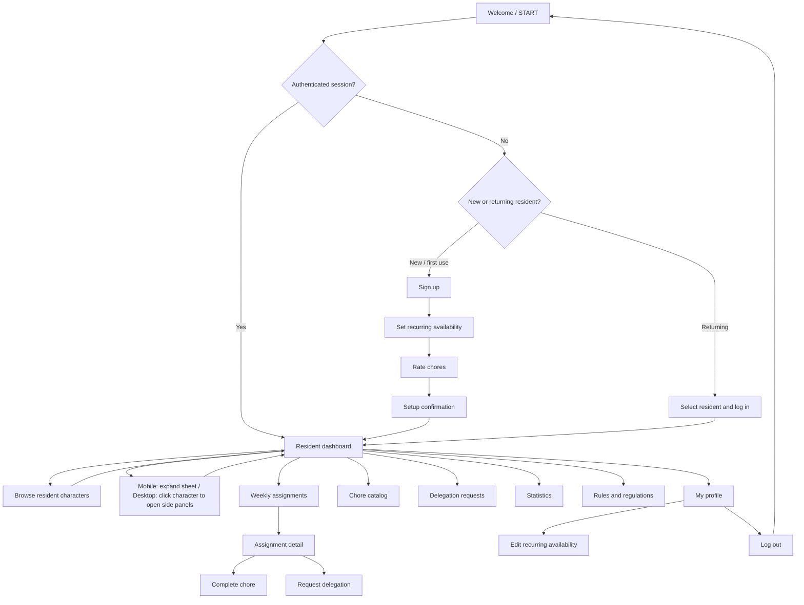

---

## 3. Case A — First-Time Resident Onboarding

### W01 — Welcome screen

- Full-screen, portrait-friendly isometric dorm illustration; title and tagline above the scene.
- Top-right resident icon opens the account entry screen (sign up or login).
- Large green `START` button near the bottom.
- First-time visitor without a session: route to signup by default, with `Already have an account? Log in` as an alternate action.
- Returning resident without a session: show login/resident selection and `Add new resident` or `Sign up`.
- Valid existing session: START proceeds to the authenticated dashboard, subject to onboarding state.
- Do not grant access based solely on a selected avatar or a browser flag. Verify identity server-side.

### W02 — Sign up / resident details

Display a friendly pixel-art group illustration, `Create your resident account`, and a simple form:

| Field | Input / validation |
| --- | --- |
| Full name | Required, non-empty; server enforces length |
| Username | Required and unique |
| Password | Required, masked; server validates password policy |
| Confirm password | Must match password; never persist this value |

Primary action: `Create account`. Secondary: `Already have an account? Log in`.

On successful signup, establish an authenticated session and proceed to W04. Display inline errors for duplicate usernames, missing values, and mismatched passwords. Passwords are never stored in plaintext or shown in profile views.

### W04 — Set recurring availability

Header: `Set your weekly availability`. Subtitle: `Use your fixed semester class schedule to choose the days you are available for dorm chores.`

Show the seven days with an explicit available/unavailable switch, initially unset or unavailable, and a summary of selected days. The resident considers school, travel, work, and other fixed commitments when selecting days.

```text
Step 2 of 3 — Weekly availability

Monday      [Available]   ON
Tuesday     [Unavailable] OFF
Wednesday   [Available]   ON
Thursday    [Available]   ON
Friday      [Unavailable] OFF
Saturday    [Available]   ON
Sunday      [Available]   ON

Selected: 5 of 7 days
This repeats every week until you change your settings.

[Save and continue]
```

- Store weekday integers 1–7 and boolean flags in `AVAILABILITY`. Save explicitly selected values for all seven days.
- Missing weekday records are unavailable, not implicitly free.
- If all days are unavailable, explain that the resident will not receive automatic assignments until at least one day is available. Allow saving a legitimate all-unavailable schedule.
- This is not a week-specific form. Do not request availability every Monday.

### W05 — Initial chore ratings

Show the active chore catalog with descriptions, due weekdays, current collective scores, rating counts, and a selectable 1–5 scale for each chore. Label 1 as very light and 5 as very demanding; ratings represent perceived intensity, not time to finish.

Residents can save individual ratings and continue after reviewing the catalog. Recommend rating all active chores; no invented score for an unrated chore. If the catalog is empty, show `No chores yet` and permit continuation. If the resident leaves some ratings blank, explain generation requires at least one active-resident rating per active chore, not a rating from every resident.

### W06 — Setup confirmation

Show `Welcome to Dormie!`, confirmation of account creation, availability saved, and rating progress. The main button is `Enter Dormie`.

On the first dashboard, show zero workload if there are no assigned chores. Do not populate a fabricated XP balance or placeholder task. Prompt the resident to view assignments or generate an eligible upcoming week.

### Onboarding interruptions

- Form errors retain safe non-password field values and explain how to resolve the issue.
- If signup succeeded but onboarding was interrupted, require login and offer resume setup based on existing availability/rating data. Any explicit onboarding-completion flag would need a documented schema decision; do not introduce an extra table.
- Resident with no fixed schedule: use the same weekday form based on the current recurring routine. Missing days remain unavailable.

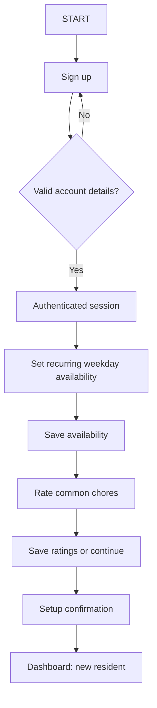

---

## 4. Case B — Returning Resident and Resident Switching

### W03 — Resident identification and login

Account switching is distinct from dashboard character browsing. Selecting another character on the dashboard only changes the displayed resident, never the authenticated account.

Show available resident profiles (display name and decorative avatar, without private information), a username field or a selected account, and password input. Provide `Log in`, `Add new resident`, and `Back` actions. A user may select a resident to prefill the username only; the password and server authentication remain necessary.

- Valid credentials: enter the current resident's dashboard and restore the appropriate state.
- Invalid credentials: show a generic login error; do not disclose passwords or account existence through authentication errors.
- Inactive account: block authentication under the server's account policy.
- Switch resident: log out or terminate the current session, select another account, and authenticate again.
- Expired session: redirect to login with a useful message and return to the requested page after successful authentication where safe.

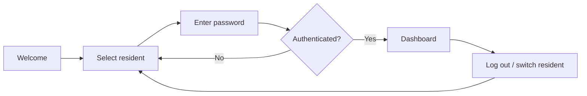

---

## 5. Case C — Resident Dashboard (Required Responsive Interactions)

The resident dashboard uses a horizontally browsable pixel-art character carousel on both mobile and desktop. On mobile, the signed-in resident initially appears with a collapsed bottom status sheet. On desktop, the signed-in resident initially appears centered with both side panels closed. Browsing another character lets residents view shared chore status without impersonating that resident. D01–D03 cover the mobile sheet and shared browsing behavior; D04–D05 below define desktop-specific behavior.

### D01 — Mobile collapsed status sheet

**Screen composition (top to bottom):**

1. App header: hamburger menu, Dormie wordmark, and pending delegation indicator for the signed-in account.
2. Active week label: Monday–Sunday period and week selector where appropriate.
3. Character carousel: large full-body pixel-art character, left/right arrow buttons, and `Swipe to browse residents` hint. Show the current resident's display name and optional position indicator (e.g., `1 of 4`).
4. Bottom status panel: visible drag handle and expand chevron, resident name, `You` or `Viewing resident` label, today's due chores and statuses, completion count, and current-week actual responsibility and completed workload points.
5. Navigation: menu or bottom navigation as defined in Section 2.

The card remains compact enough to keep the full-body character visible. Display a `No chores due today` state if appropriate. Provide `View weekly assignments` and an explicit `Expand details` control.

### D02 — Mobile expanded status sheet

When the resident drags the status panel upward, slide the panel to an expanded snap position. Reduce the visible character area to the upper body or portrait while keeping the app header and carousel arrows accessible. Preserve the selected resident and selected week. Use a scrollable content area within the panel.

**Expanded content:**

- Resident name, identity indicator, and selected week.
- Current-week overview: currently responsible chores and originally assigned chores, clearly differentiated, with deadline, status, workload points, and accepted-delegation labels where applicable.
- Workload summary: originally assigned, actual responsibility (primary metric), completed workload, previous four completed weeks' sum, cumulative points, and average points per eligible week. Display points to two decimal places.
- Progress indicator: completed chores / currently responsible chores. Label the metric and denominator. If there are no responsible chores, display an empty state rather than a misleading percentage.
- Delegation alert for the signed-in resident only, including pending incoming and outgoing requests. Do not expose another resident's private request reasons or account settings.
- Quick actions: open assignment detail and mark complete or request delegation only where permitted by Part 3; open full statistics.
- Decorative achievements, XP, levels and streaks from earlier mockups are optional concept features outside the baseline MVP. Use factual contribution counts and workload points instead of inventing rewards or productivity rankings.

Show an onboarding checklist for the signed-in resident when recurring availability or initial chore ratings are incomplete, with links to resume setup.

A downward drag on the handle or upper edge of the panel collapses it. The chevron button toggles the same two states. Collapsing does not change the selected character. If there are no assignments for the selected week, show a clear empty state and allow navigation to the week generator. If assignments exist but the viewed resident has none, show `No chores assigned to [resident] this week`.

### D03 — Horizontal resident browsing

- Swipe left on the character area to view the next resident; swipe right to view the previous resident. Tap the left/right arrow buttons for the same actions. On desktop, use arrows, adjacent character clicks, or keyboard navigation as defined in D04–D05.
- Display active residents in a stable order (proposed default: ascending `resident_id`). Start with the signed-in resident selected. Use cyclic navigation so the final resident advances to the first, and the first resident goes back to the final resident. With a single active resident, disable or hide the navigation arrows and swipe hint.
- Replace the character, resident name, and all displayed status data together. Keep the selected week and current details visibility unchanged during arrow/swipe browsing so residents can compare the same information across profiles. On desktop, explicitly clicking any character opens both panels. Reset internal scroll to the top on resident change.
- Label the resident clearly: `You · Alex` versus `Viewing Bea`, for example. Provide a visible `Return to my status` action while viewing another resident.
- While browsing another resident, show their shared chore responsibilities, completion status, and workload statistics as read-only. Hide personal settings, credentials, private delegation reasons, edit actions, completion actions, and delegation controls for their chores. The server must still enforce authorization on all endpoints.
- Account-level navigation, incoming requests, profile settings, availability edits, and chore ratings continue to operate as the signed-in resident. A real account change requires the separate authenticated flow in Section 4.

### Mobile gesture behavior and input alternatives

| Input | Region | Result |
| --- | --- | --- |
| Swipe left | Character carousel | Next resident |
| Swipe right | Character carousel | Previous resident |
| Tap previous / next | Carousel arrow | Same navigation as swipe |
| Drag upward | Status panel handle/header | Expand status panel |
| Drag downward | Status panel handle/header | Collapse status panel |
| Tap expand/collapse chevron | Panel header | Toggle status panel |
| Scroll vertically | Expanded panel body | Read the selected resident's details without changing panel state |
| Tap Return to my status | Viewing-resident banner | Select signed-in resident |
| Switch account | My Profile | Authenticate as the chosen account; not a carousel action |

### UI state model and implementation guidance

Maintain separate UI state for `authenticatedResidentId` (server session), `viewedResidentId` (client-side selected profile), `selectedWeekId`, `viewportMode` (`mobile` or `desktop`), and `detailsOpen` (boolean). Derive mobile `statusPanelState` (`collapsed`/`expanded`) and desktop panel visibility (`closed`/`open`) from `detailsOpen`. These UI fields do not change server identity or require new database records. Preserve selected resident, week and details visibility across viewport changes; on new login reset to the authenticated resident with details closed.

- Use vanilla JavaScript pointer events or a lightweight equivalent for horizontal swipes and vertical panel drags. Keep gestures scoped to their respective regions, distinguish the dominant movement axis, ignore accidental short movements, and avoid intercepting normal vertical scrolling or taps on form controls.
- For mobile only, use two snap positions (collapsed and expanded), with a short transition. If a drag is insufficient to change state, return to the current snap position. Respect `prefers-reduced-motion` and offer instant transitions when requested.
- Do not trap normal browser scrolling. Desktop must not use a vertical sheet drag or snap positions as its primary details interaction. Use real focusable buttons with descriptive accessible labels, appropriate `aria-expanded` on the toggle, and a concise announcement when the viewed resident changes.
- Load status from the existing assignment/statistics services. During loading, indicate the selected resident and avoid displaying a previous resident's points under a new name. Handle failure with an inline retry. Ignore stale asynchronous responses after a resident or week change.
- Refresh affected status data after successful completion, delegation acceptance/cancellation/rejection, or assignment generation. Do not duplicate workload calculations in JavaScript. On sign-out, clear account-specific UI state; after successful new login, select that account's character and reset details to closed (collapsed sheet on mobile).
- Use original or licensed character art as presentation assets mapped to the active residents, with a fallback avatar. No custom-avatar database fields are required by the baseline.

### Mobile dashboard interaction workflow

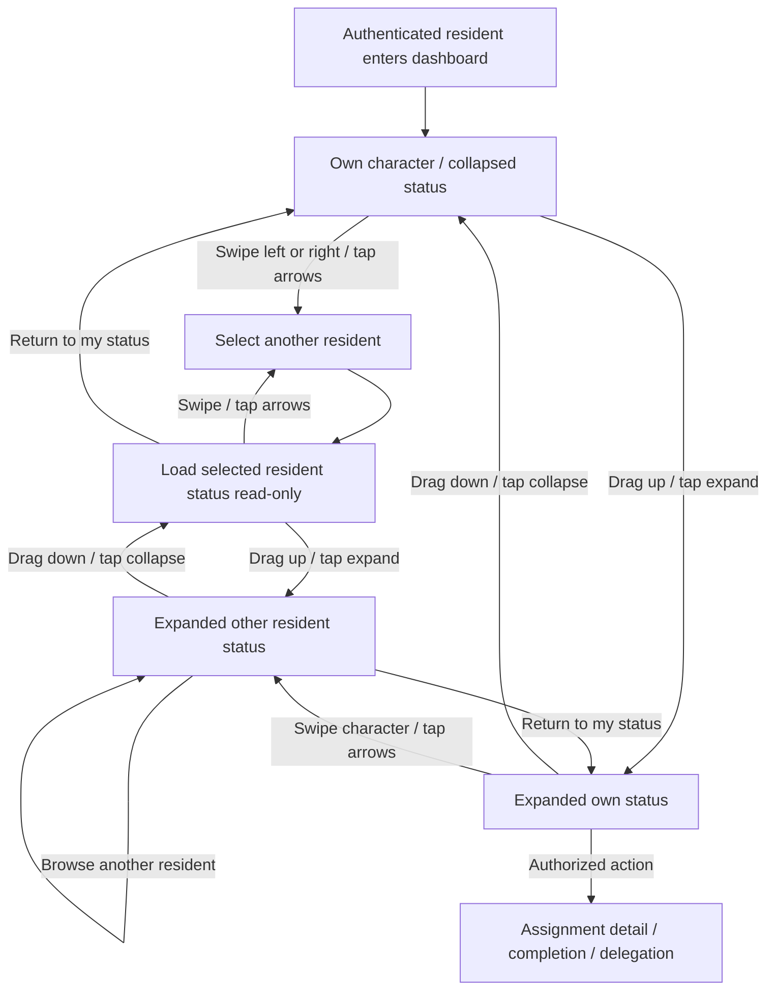

### Mobile and shared dashboard scenario acceptance checks

| Scenario | Expected behavior |
| --- | --- |
| First login as Alex | Alex appears with collapsed status and `You` label |
| Swipe left to Bea | Bea's avatar and workload appear; Alex remains authenticated |
| Swipe right | Previous resident appears; no account change |
| Drag up while viewing Bea | Expanded Bea status; no mutation actions appear |
| Swipe while expanded | Next resident loads; panel stays expanded |
| Drag down | Current character becomes fully visible; panel collapses |
| Return to my status | Alex's own details return; only authorized actions are available |
| Select another account in Profile | Separate logout/login workflow; identity changes only after authentication |
| Screen reader / keyboard | Equivalent arrow and expand/collapse buttons work without touch gestures on mobile; desktop uses D04–D05 controls |
| No assignments or zero workload | Display correct empty state and `0.00` values; no fabricated progress |

### D04 — Desktop character browsing (side panels closed)

**Desktop design direction:** coverflow-inspired resident selection (reference: Shaky game carousel), using original Dormie pixel-art characters and a full-width dorm common-room scene rather than rectangular game covers. Use the two latest desktop screenshots in `references/desktop/` as the controlling visual direction for this dashboard, ahead of older desktop sidebar/bottom-sheet concepts.

- Design for a 1440 × 900 desktop viewport and adapt fluidly. Proposed breakpoint: desktop at CSS viewport width >= 1024 px; below that use mobile sheet presentation rather than squeezing two columns around an unreadable character. Record the breakpoint in `DECISIONS.md` and verify it at actual content widths.
- Top navigation stays available above the stage. No persistent dashboard sidebar, account control and viewed character are distinct.
- Use a warm pixel-art dorm interior as the decorative stage, with the selected full-body resident large, centered, sharp and emphasized with a subtle outline/ground highlight. Neighbors appear smaller, slightly angled or offset and dimmer, but remain identifiable and clickable; use CSS transforms and layering, not a mandatory 3D engine. Support original/appropriately licensed assets and reduced motion.
- Previous/next buttons flank the carousel; nameplate and position indicators identify the viewed resident. Display `Click a resident to view status`. A single resident remains centered without redundant controls. Default order remains ascending resident ID, cycling at both ends.
- Clicking an arrow, pagination indicator, or using a focused carousel's Left/Right (optionally A/D) keys browses without automatically opening closed panels. Pointer horizontal drag is optional, not required. Do not intercept keys during typing or outside the carousel.
- Clicking any resident character selects that resident, brings them to the center (if necessary), and opens both contextual status panels. A focused character button activates with Enter/Space. Hover/focus may highlight it, but never opens details alone.

### D05 — Desktop selected resident (two contextual panels open)

Keep the selected character visible, full-body and centered. Slide/fade the two panels into the space on either side of the character; no vertical dragging, bottom sheet, or modal overlay on desktop. Compact neighboring characters if needed, without covering the selected character or navigation arrows.

| Left panel: Resident Info | Center: Resident Carousel | Right panel: Current Status |
| --- | --- | --- |
| Display name, avatar, `You` / `Viewing [name]`, member-since if available | Selected full-body avatar and nameplate | Selected week and responsible/originally assigned chores with due dates, status and frozen workload points |
| Actual responsibility summary: selected week, previous four completed weeks, cumulative, average per eligible week | Previous/next arrows, focusable character, optional pagination | Completion count, all three weekly workload metrics, assignment detail links |
| Factual contribution summary; onboarding prompts for own account only | Character remains visible as the main focal point | Own-account-only pending delegation counts and eligible task actions; full statistics link |

The left summary uses actual responsibility as the default fairness metric. The right panel distinguishes originally assigned, actual responsibility, and completed workload. Optional tabs (Overview, Chores, History, own-account Delegations) may organize details without changing the underlying service logic. Do not require persistent achievements, XP, room numbers or any extra fields shown only in artwork. Use independently scrollable panels or normal page scrolling when vertical content exceeds available height. Do not obscure controls.

Suggested layout: CSS grid `minmax(250px, 1fr) minmax(280px, 1.1fr) minmax(300px, 1.2fr)` with responsive gaps and padding; switch to compact presentation if not enough space. These dimensions are implementation defaults, not fixed pixel requirements. Panels are non-modal and have an explicit close/toggle control with `aria-expanded`; Escape closes panels when focus is in the dashboard and no higher-priority dialog is open. Restore focus to the selected character when closing via keyboard. An outside-stage click may close panels only when it does not interfere with navigation or other controls. Do not close merely because a user browses with arrows. Clicking a different character or browsing with arrows/keys while panels are open updates both panels together and keeps them open. Clicking the already selected character again may toggle them closed (proposed default: toggle; provide a separate close button as well).

When viewing another resident, both panels display the selected resident's shared data read-only, no completion/delegation mutations or private request details. The account menu and private notifications still belong to the signed-in account. `Return to my status` selects that account and keeps the current panel visibility. Only an explicit authenticated account switch changes identity.

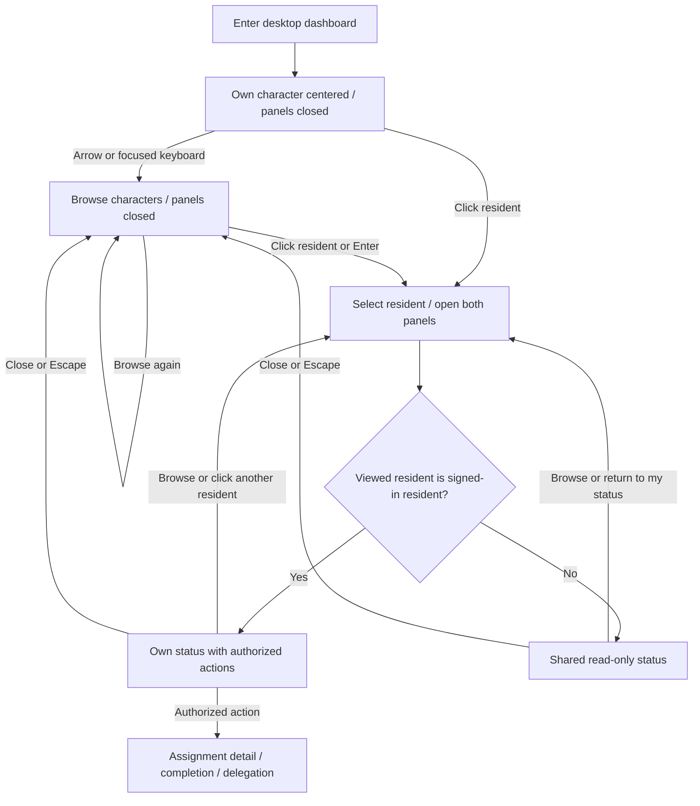

### Desktop scenario acceptance checks

| Scenario | Expected behavior |
| --- | --- |
| Login on desktop as Alex | Alex centered; both panels closed; top navigation visible |
| Arrow to Bea before opening | Bea centered; panels remain closed; Alex session unchanged |
| Click Bea | Bea centered; paired panels open with Bea's shared data, no private or mutation actions |
| Click or navigate to Carlo while open | Both panels refresh for Carlo together; selected week and open state retained |
| Click selected character again / close / Escape | Both panels close; selected resident retained |
| Return to my status | Alex becomes centered; open state retained; authorized controls enabled only where permitted |
| Resize desktop to mobile while open | Same resident/week shown in expanded bottom sheet; no account change |
| Resize mobile to desktop while collapsed | Same resident/week shown with side panels closed |
| Single active resident / loading / no chores | Navigation controls disabled when redundant; loading/error/empty states accurate; no stale identity or fabricated data |
| Keyboard and reduced motion | Focused arrows and character activation work; panels are accessible and motion is reduced |

---

## 6. Case D — Chore Catalog and Intensity Rating

### C01 — Common chore catalog

All authenticated residents see active weekly chores. Show name, description, due weekday, collective mean (two decimal places), number of ratings, and the current resident's own rating or `Not rated`.

Example from Part 5 seed data:

| Chore | Due | Mean | Ratings |
| --- | --- | ---: | ---: |
| Sweep floor | Monday | 2.00 | 4 |
| Wash dishes | Tuesday | 3.00 | 4 |
| Clean bathroom | Thursday | 4.50 | 4 |
| Mop floor | Saturday | 3.50 | 4 |

### C02 — Rate or update a chore

Open chore detail; present the 1–5 integer scale, current personal rating, collective mean and count, and `Save rating`. Save through the rating service. An edit updates the existing rating rather than creating a duplicate. Explain that changes affect future assignments only; historical workload points remain unchanged.

If no active residents have rated the chore, show `Unrated — rate before generation`; never display a zero or default score as the intensity mean.

### C03 — Add, edit, or retire a common chore

Authenticated residents may manage the shared catalog under Part 3. Add/edit form: name, description, due weekday (Monday–Sunday), weekly frequency (fixed). Do not include estimated duration. Retire via confirmation (deactivate rather than deleting history, if using `is_active`). Preserve already-generated assignments and their stored points. Apply the source constraints and document how due-weekday edits interact with existing assignments in `DECISIONS.md`.

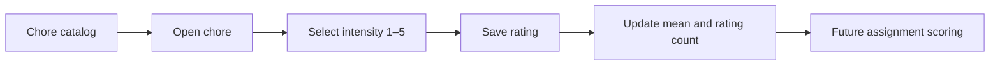

---

## 7. Case E — Weekly Assignments and Generation

### A01 — Assignments overview

Show a week picker with exact Monday–Sunday dates in `Asia/Manila`, `My chores` / `All chores` filter, and the list grouped by due weekday. Each assignment row shows chore name, due date, current responsible resident, workload points (two decimals), and pending/completed status. Show the original assignee when a delegation changes responsibility; do not confuse assignment status with delegation status.

Use the Part 5 fixed demo week November 9–15, 2026 for documentation and classroom examples; do not hardcode it as the production UI's current week.

### A02 — Generate assignments

For an eligible upcoming week, authenticated residents see `Generate assignments`. Explain that Dormie balances actual responsibility points using availability, the previous four completed weeks (or fewer eligible weeks), and the target week's planned workload. The allocator is deterministic and explainable, not a guarantee of a globally optimal distribution.

| Generation outcome | UI response |
| --- | --- |
| Success | Show generated chores and their assignees; link to rationale |
| Active chore has zero ratings | Block generation; list unrated chores with links to rating screens |
| No eligible resident for a chore | Show specific unassigned warning and due weekday; link to availability; permit retry for missing assignments |
| Week already generated | Show existing assignments; generate missing chores only where allowed |
| Invalid week | Explain Monday start/Sunday end constraint |
| Request failure | Show error and safe retry; do not imply success before server confirmation |

Generate in a transaction through the assignment service; no automatic external scheduler. Do not reshuffle or duplicate existing records on refresh or retry.

### A03 — Why was this assigned?

Assignment details include original assignee, current responsible resident, due date, frozen workload points, status, and a `Why this assignment?` panel displaying server-provided rationale:

- Collective chore score at generation.
- Due-weekday availability check.
- Historical average points used and current planned points.
- Adjusted burden, selection rationale, and tie-break basis (if applicable).

Adjusted burden = historical average per eligible week + current-week actual responsibility points. Use the server's deterministic ordering and tie-break rules from Part 3. Do not simulate the algorithm in frontend JavaScript or invent historical rationale if the service does not return it. Document how rationale is retained or reconstructed without a new physical table.

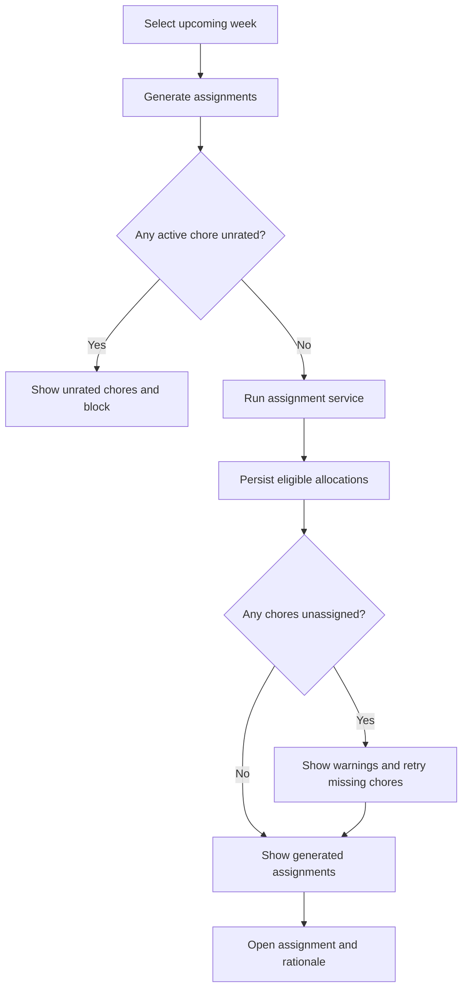

---

## 8. Case F — Chore Completion

### A03 — Assigned chore details

Show description, due date, points, status, original assignee, actual responsible resident, and rationale. For an incomplete assignment, show `Mark as complete` only to the current responsible resident. A personal checklist from the visual concept may be rendered as non-persistent guidance in the description, but no checklist completion or verification model is required.

### A04 — Completion confirmation and result

Display `Mark this chore as completed?`, chore name and credited points, with `Confirm` and `Cancel`. On confirmation, the backend verifies authorization, sets `status = completed` and records the UTC timestamp. Refresh dashboard and statistics; show local completion timestamp, `Completed`, and point totals. Completed points are the assignment's frozen workload points, not a separate reward currency.

| State | UI behavior |
| --- | --- |
| Incomplete, currently responsible | Enable completion |
| Pending delegation | Original assignee remains responsible until acceptance |
| Accepted delegation | Only accepted substitute may complete |
| Completed | Read-only status; no repeat credit or new delegation |
| Unauthorized or state changed | Reject action and reload current assignment |

A pending delegation and completion may race; require the server to revalidate state and prevent accepting a delegation for an already-completed task. Follow Part 3; document any automatic pending-request cancellation decision.

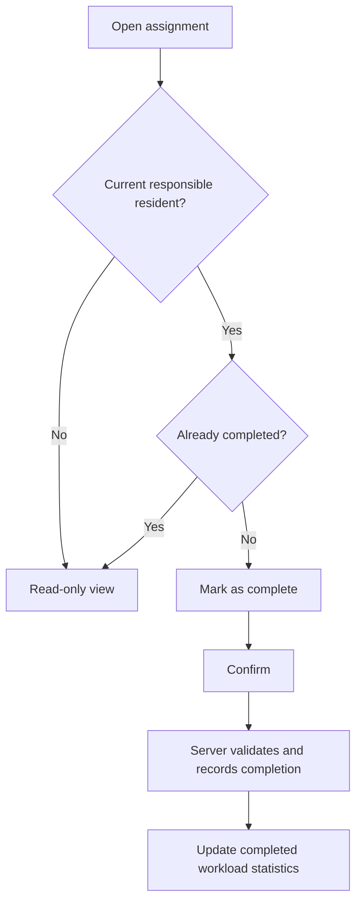

---

## 9. Case G — Delegation / Substitution

Use `Request substitute` as the resident-facing action and `Delegation` as the database/business term.

### G01 — Request a substitute

Only the original assignee of an incomplete assignment may initiate delegation if no pending or accepted delegation exists. Show chore, due date, points, reason textarea, and eligible residents. Eligibility: active, not original assignee, explicitly available on the due weekday. Display current-week actual responsibility workload for transparency; ranking by workload is a suggested presentation choice, not another eligibility rule.

Choose a resident, enter a non-empty reason, and press `Send request`. If no eligible substitute exists, show `No available substitutes for this due day`; responsibility remains unchanged. Validate all conditions again server-side.

### G02 / G03 — Incoming and outgoing requests

A grouped page contains `Incoming`, `Outgoing`, and `History`. Pending incoming requests show original assignee, chore, due date, points and reason. Only the intended substitute sees active `Accept` and `Reject` controls. Original assignee sees `Cancel request` on a pending outgoing request. Historical rows show timestamps and status without destructive controls.

### G04 — Delegation result states

| State | Message / controls | Responsible resident |
| --- | --- | --- |
| Pending | Waiting for substitute; original assignee may cancel | Original assignee |
| Accepted | Assignment transferred; no further delegation | Accepted substitute |
| Rejected | Request declined; original assignee may submit a new request | Original assignee |
| Cancelled | Request cancelled; original assignee may submit a new request | Original assignee |
| No eligible substitute | No request created; show availability warning | Original assignee |
| Conflict / stale request | Refresh state; explain why action was blocked | Determined by backend |

On acceptance, preserve `ASSIGNMENT.resident_id` and transfer actual responsibility through the accepted `DELEGATION` record. Never count points twice. Acceptance is not completion, and no delegation chains are permitted. Preserve rejected and cancelled history. Recalculate displayed statistics after acceptance. The current assignee and target substitute must never be inferred solely from client state.

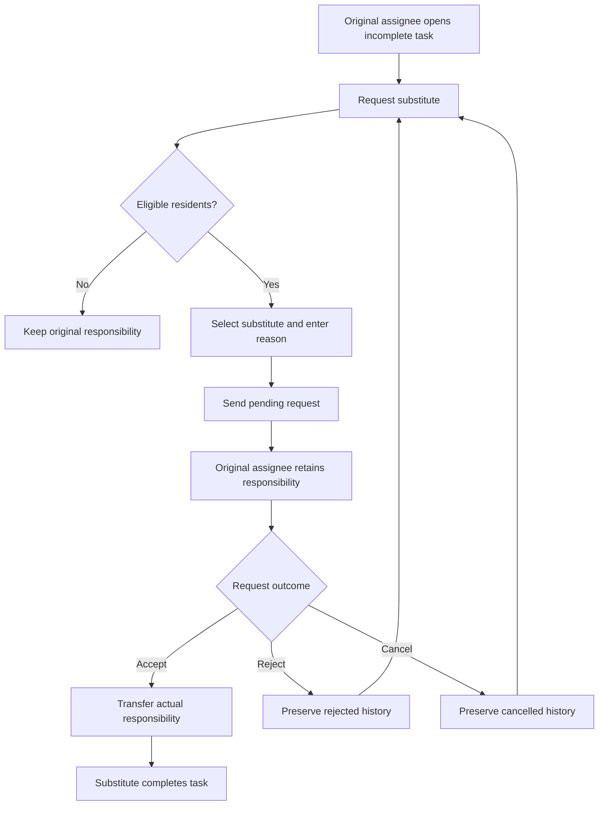

---

## 10. Case H — Statistics and Fairness Reporting

### S01 — Personal and group statistics

Provide resident/group selector, week picker and period filters: selected week, previous four completed weeks, all-time cumulative, and per-eligible-week average. Allow viewing each workload metric independently. Use cards for totals and a horizontal bar or trend chart for comparison; include an accessible table equivalent.

| Metric | UI definition |
| --- | --- |
| Originally assigned workload | Points assigned originally to this resident, regardless of delegation |
| Actual responsibility workload (primary) | Points credited to current responsible resident, including accepted delegations |
| Completed workload | Points from completed assignments only, credited to the responsible resident |

Example: Alex originally receives a 4.50-point task and Bea accepts the delegation. Alex retains 4.50 originally assigned points; Bea receives 4.50 actual responsibility points; completed workload remains zero for this task until Bea completes it, then Bea receives 4.50 completed points. This is an illustrative scenario, not a claim about the actual seeded delegation.

- Include zero-point residents; do not filter them out of group comparisons.
- Exclude weeks before a resident joined from eligible-week averages.
- Format points to two decimal places, keep full precision in computations.
- Show `No eligible weeks` instead of an undefined average when appropriate.
- Derive statistics from assignments/delegations with SQL views or queries, not a physical `WORKLOAD_HISTORY` table.
- Group tables show all three metrics, with the actual-responsibility metric visually emphasized. Avoid presenting lower workload as poor productivity or low effort.

---

## 11. Case I — Profile and Recurring Availability Updates

### P01 — My Profile

Show resident name/username and a decorative avatar. Include `My availability`, `My chore ratings`, `My statistics`, `Switch resident`, and `Log out`. Do not display the password hash. Profile editing is limited to supported resident fields and authorized actions.

### P02 — Edit my availability

Reuse W04 with existing values. Show the selected days and a note explaining changes apply to future generation and eligibility checks; do not silently redistribute previously generated assignments. If an unexpected conflict affects an existing assignment, use the delegation workflow. A changed recurring schedule should not require a separate temporary-unavailability record.

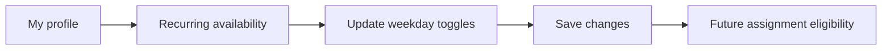

---

## 12. Case J — Dorm Rules & Regulations

### R01 — Rules overview and expanded category

Access from the menu. Use a small dorm illustration and text: `Keep our dorm safe, clean, and respectful for everyone.` Display accordion rows with icons and accessible expand/collapse controls.

Proposed category placeholders (replace with actual approved dorm rules):

| Category | Content to supply |
| --- | --- |
| Cleanliness & chores | Responsibilities, acceptable shared-area cleanliness |
| Shared spaces | Use and care of shared facilities |
| Waste management | Sorting, disposal, bin use |
| Quiet hours | Agreed hours and noise limits |
| Guests & visitors | Visitor access and resident responsibilities |
| Safety & security | Doors, keys, emergency procedures |
| Respect & conduct | Consideration of other residents |
| Violations & penalties | Approved resolution process, if applicable |

When a category expands, show its rules and collapse control. Keep the content read-only and local/static (template or configuration). Do not invent actual quiet-hour times, fees, punishments, or a violation tracking module. Until residents supply policies, display `Rules pending approval` or explicitly labeled example content.

---

## 13. Shared UI States, Integration and Acceptance Checks

### Shared UI behavior

- Loading: disabled submit button and progress indicator for pending service calls; prevent double submission.
- Success: confirmation only after successful server response; update affected views.
- Empty: clear reason with appropriate next action (e.g., no chores, no assignments, no requests, no ratings).
- Error: field-level feedback for validation, clear general message for unexpected failure, safe retry.
- Authorization: hide unauthorized actions for clarity while enforcing authorization on the API; never rely on client controls alone.
- Status badges: distinguish assignment `Pending`/`Completed` from delegation `Pending`/`Accepted`/`Rejected`/`Cancelled`.
- Dates: local Asia/Manila calendar; convert UTC timestamps for display.
- Keep input text on recoverable errors (except sensitive password values where appropriate) and use confirmation for consequential actions.

### UI-to-service integration

| Screens | Backend service (Part 3) | Physical entities |
| --- | --- | --- |
| Signup, login, profile | Auth | RESIDENT |
| Availability setup and editor | Availability | RESIDENT, AVAILABILITY |
| Chore catalog and ratings | Chore & Rating | CHORE, CHORE_RATING, RESIDENT |
| Assignments and generation | Weekly Assignment | WEEK, ASSIGNMENT, CHORE, AVAILABILITY, CHORE_RATING, RESIDENT, DELEGATION |
| Completion | Weekly Assignment | ASSIGNMENT, DELEGATION |
| Delegation views and actions | Delegation | DELEGATION, ASSIGNMENT, AVAILABILITY, RESIDENT |
| Dashboard and statistics | Statistics | WEEK, ASSIGNMENT, DELEGATION, RESIDENT (derived reporting) |
| Dorm rules | Static UI content | No new entity |

Exact endpoint paths follow repository conventions. Use real authentication, validated form submissions, service calls, and dynamic database records. Keep allocation and statistics logic in backend services, not templates.

### UI acceptance checklist (supplements Part 5)

- [ ] Welcome screen has functional START and resident/account icon; new and returning users reach the appropriate entry flow.
- [ ] Signup validates fields; login verifies credentials; switching accounts requires authentication.
- [ ] Mobile dashboard opens on the authenticated resident with collapsed status; horizontal swipe and arrow taps browse residents without changing the session.
- [ ] Desktop dashboard opens with a centered authenticated resident, top navigation and both side panels closed. Clicking a resident opens the left Resident Info and right Current Status panels with the character visible between them; no drag-up on desktop.
- [ ] Desktop arrows and keyboard browse without opening closed panels; browsing with panels open updates both panels; close/Escape retains selection. Resizing preserves resident, week and details visibility.
- [ ] On mobile, upward drag expands the status sheet, downward drag collapses it, and the chevron provides an equivalent accessible control.
- [ ] Horizontal browsing preserves expansion state and selected week; the avatar, identity, and workload data update together.
- [ ] Other residents' status is read-only, with a clear viewed-resident label and a return-to-my-status action; server authorization blocks cross-resident mutations.
- [ ] Gesture conflicts are handled; scrolling expanded content remains usable, keyboard/desktop controls work, and reduced-motion settings are respected.
- [ ] Initial availability and ratings setup lead to a functional dashboard, with a recoverable interrupted setup flow.
- [ ] Availability editor stores weekday booleans only and displays saved settings on return.
- [ ] Residents create/update shared weekly chores and own 1–5 ratings; means and rating counts display accurately.
- [ ] Week selector uses Monday–Sunday dates and generation shows success, zero-rating block, unassigned and existing-week states.
- [ ] Assignment rationale and frozen points appear on details; completion only succeeds for authorized residents.
- [ ] Delegation UI supports request, pending, accept, reject, cancel, no eligible substitute, and history states.
- [ ] Accepted delegation preserves original assignee, shows new responsibility and updates points without double counting.
- [ ] Personal and group statistics expose all three metrics and required date ranges, including zero-point residents.
- [ ] Read-only dorm rules accordion uses approved or clearly labeled placeholder policies.
- [ ] Responsive layouts work on narrow phones and desktop, with readable errors and accessible controls.
- [ ] Part 5 demo accounts and deterministic seed data drive the UI; mockup sample names do not substitute for those records.
- [ ] No new physical tables or excluded features are introduced unintentionally; `DECISIONS.md` records assumptions.

---

## 14. Proposed Scope Change — Detailed Fixed Class Schedule (Not Approved in Baseline)

The latest UI discussion proposed asking for a resident's fixed class timetable directly during first registration. The original specifications explicitly exclude class timetable ingestion and class-hour conflict detection, and `AVAILABILITY` supports only weekday booleans. A class timetable therefore cannot be treated as a working MVP scheduling feature without revising Parts 1–3 and 5.

If the project owner approves this scope change, the following is the proposed UI sequence:

1. START → sign up → resident details → `Fixed Class Schedule` → `Review Availability` → initial chore ratings → setup confirmation → dashboard.
2. Fixed Class Schedule overview: Monday–Sunday tabs with an entry count for each day; `Add class`, `Edit`, `Delete`, `Save schedule`, and `No fixed schedule` actions.
3. Add/edit class sheet: weekday, start time, end time, optional subject label; validate required times, end after start, and overlapping entries according to the approved rule.
4. Review Availability: display class/commitment periods separately from resident-declared chore availability. Require residents to confirm availability; never assume all time outside a class is available.
5. After onboarding, Profile → Class Schedule allows editable recurring entries; retain one-time setup and updates only when routine changes.
6. If hour-level assignment is required, define chore scheduling times or windows, availability granularity, conflict policies, and the corresponding schema/API/tests first. Do not use class or chore duration as workload intensity scoring.

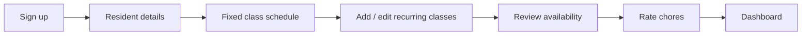

**Implementation gate:** Until the detailed class timetable requirement is approved and the other documents revised, implement W04 as recurring weekday availability based on the resident's semester routine, not a class timetable database. Other concept-only features (photo/peer verification, persistent XP and badges, room data) require similar explicit scope decisions before implementation.

---

## 15. Visual References and Delivery Notes

Use the supplied Dormie mockups for art direction, not as literal UI requirements. Recreate the interface with editable, responsive components and actual data. The welcome illustration, avatar artwork and decorative graphics may be discrete raster/SVG assets; form controls, text, charts, cards and buttons must remain real interactive UI elements. Do not use flattened screenshots as the app screens.

### Mobile visual references (portrait browser layout)

The supplied `references/mobile/` folder is the controlling mobile visual reference set. Preserve the original full-body character carousel, horizontal swipe/tap navigation, and vertically draggable status sheet in D01–D03. The welcome screen retains the top-right resident icon and START button. The storyboard files are grouped by scenario so each workflow can be implemented individually.

| Reference | Screen or workflow |
| --- | --- |
| [Welcome screen](references/mobile/00_welcome_screen.png) | Game-style entry screen and resident account access |
| [Overall screen inventory](references/mobile/00_overall_screen_inventory.png) | Original mobile art direction and rules screen |
| [01 Onboarding](references/mobile/01_onboarding.png) | New resident registration, recurring availability, ratings and setup |
| [02 Returning resident](references/mobile/02_returning_resident.png) | Existing resident login and access |
| [03 Dashboard](references/mobile/03_dashboard.png) | Character carousel, collapsed and expanded status sheet |
| [04 Chore rating](references/mobile/04_chore_rating.png) | 1–5 intensity ratings and collective averages |
| [05 Weekly generation](references/mobile/05_weekly_generation.png) | Generate assignments, warnings and assignment rationale |
| [06 Completion](references/mobile/06_completion.png) | Direct completion and confirmation |
| [07 Delegation](references/mobile/07_delegation.png) | Request, accept, reject and cancel workflows |
| [08 Statistics](references/mobile/08_statistics.png) | Personal and group workload reporting |
| [09 Profile and availability](references/mobile/09_profile_availability.png) | Profile and recurring weekday settings |
| [10 Rules](references/mobile/10_rules.png) | Proposed read-only dorm rules categories |

### Desktop visual references (landscape browser layout)

- [Closed carousel](references/desktop/01_carousel_closed.png): character browsing without status panels.
- [Open status panels](references/desktop/02_status_panels_open.png): selected character centered between left and right panels.
- [Coverflow inspiration](references/desktop/03_coverflow_inspiration.png): interaction and perspective only; retain Dormie branding.

The latest desktop reference pair supersedes earlier desktop dashboard mockups. The approved specification takes precedence over illustrative XP, achievements, room numbers and inconsistent demo totals in all mockups. Where demo names, points, class times or verification controls conflict with Parts 1–3 and 5, use the baseline technical requirements and the case-specific behaviors above. Do not implement additional database entities, detailed class timetables, or objective photo verification solely because they appear in a reference image.

### Original seven-view proposal crosswalk

| Original view | Revised specification |
| --- | --- |
| Login / Register | W01–W03, first-time and returning-resident workflows |
| Dashboard | D01–D05, shared character carousel, mobile draggable status sheet, desktop click-to-open paired panels, and onboarding prompts |
| Chores & Ratings | C01–C03, catalog, ratings, collective metrics and management |
| My Availability | W04 / P02, recurring weekday editor |
| Weekly Assignments | A01–A04, generation, rationale, completion |
| Delegations | G01–G04, incoming/outgoing requests and history |
| Workload Statistics | S01, personal and group comparisons |

The welcome/title screen, resident browsing states, profile/settings, and static dorm policy page extend the presentation and navigation; they do not replace the original seven core views.

Continue to Part 5 for deterministic seed data, API/service tests, implementation order, and delivery criteria.
