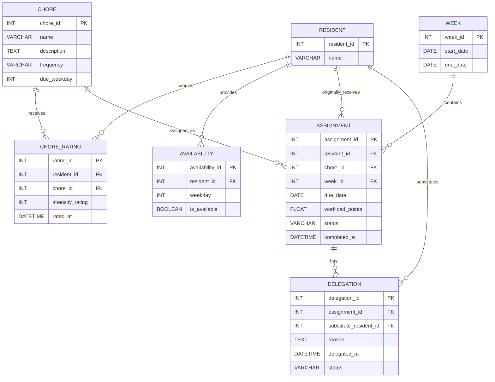

# DS 187: Automated Weekly Dormitory Chore Assignment and Monitoring System

> **Instructions for Codex CLI:** Build a complete, runnable, local-first web application from this specification. This document is the implementation brief and source of truth for the first working version. Do not stop at scaffolding, mockups, or an ERD. Implement the database, migrations, backend, frontend, tests, sample data, and setup documentation. If you need to make a choice not specified here, choose the simplest maintainable option, document it in `DECISIONS.md`, and continue.

## 1. Project goal and scope

Create a database-driven system for **residents of one shared dormitory** to distribute and monitor recurring household chores fairly. The application must let residents:

1. Create/access their resident profiles.
2. View the common chore catalog and **rate the perceived intensity** of each chore on an integer scale from **1 to 5**.
3. Enter their **recurring weekday availability** once, based on their semester schedule, and update it when circumstances change. **Do not require new availability submissions every week.**
4. View chore assignments within a fixed **Monday–Sunday** week.
5. See why a chore was assigned, using availability and workload history.
6. Mark tasks as completed.
7. Request a delegation when unexpectedly unavailable, with another eligible resident accepting or rejecting the request.
8. View **weekly, cumulative, and average workload points** for themselves and the group.

Only dormitory residents use the application. **No dormitory manager/administrator role, multi-dorm/room module, class-schedule entity, or temporary-unavailability entity.** Do not invent those features.

The system's main objective is **fair and explainable allocation**, not productivity measurement. Different residents perform chores at different speeds, so **do not use estimated time/duration for workload scoring**.

## 2. Technology and delivery

Use this stack unless an existing repository already has a suitable working stack:

- **Backend:** Python 3.12+, FastAPI, SQLAlchemy 2.x, Alembic, Pydantic.
- **Database:** SQLite for easy local classroom demonstration, with conventional relational schema and foreign keys enabled. Keep database access portable enough to switch to PostgreSQL later.
- **Frontend:** Simple responsive web UI using server-rendered templates plus lightweight JavaScript and CSS, or an existing repository frontend framework if present. No external paid services.
- **Tests:** pytest, including API/integration tests with a temporary test database.
- **Timezone:** `Asia/Manila` for scheduling and displayed timestamps; store UTC timestamps consistently and convert on display.

Include `README.md` with exact setup, migration, seed, test, and run commands; `.env.example` if configuration is used; and `DECISIONS.md` for implementation assumptions.

If starting from an empty repository, create a clean directory structure such as `app/models`, `app/services`, `app/api`, `app/templates`, `app/static`, `alembic`, and `tests`. Include a `requirements.txt` or `pyproject.toml` with pinned or bounded dependencies.

## 3. Entity-relationship design

Implement **seven physical entities**:

### Relational implementation details

Use the following fields and integrity requirements. The Mermaid types above are conceptual; in actual SQLite migrations use appropriate SQLAlchemy types, lengths, `NOT NULL`, uniqueness, foreign keys, indexes, and `CHECK` constraints.

**RESIDENT**
- `resident_id` primary key; `name` nonempty, e.g. `VARCHAR(100)`.
- Implementation additions permitted for functional authentication: `username` unique, `password_hash`, `is_active`, `joined_at` (never store plaintext passwords). These support resident-only access and fair treatment of newcomers.

**CHORE**
- `chore_id` primary key, `name`, `description`, `frequency`, `due_weekday`.
- `due_weekday`: 1=Monday through 7=Sunday, consistently in UI, database, and code.
- For **MVP**, support `frequency = 'weekly'` only; each active chore occurs once in its configured weekday each week. Validate this instead of pretending other frequencies work. Allow an `is_active` field for retiring chores without deleting history.
- Do **not** add an `estimated_minutes` field.

**CHORE_RATING**
- `rating_id` primary key; `resident_id` FK; `chore_id` FK; `intensity_rating` integer 1..5; `rated_at` timestamp.
- Unique (`resident_id`, `chore_id`): one current rating per resident per chore. Residents may edit a rating (update the row and `rated_at`).
- Ratings from active residents determine a chore's **collective workload score**: arithmetic mean of valid ratings. Report count of ratings alongside the mean. A chore with zero ratings is **not eligible for automatic generation** until at least one rating exists; report this prominently. Do not silently invent a default score.

**WEEK**
- `week_id` primary key; `start_date` a Monday; `end_date` the following Sunday (exactly six days later).
- Unique `start_date`; prevent duplicate/overlapping weeks through validation and constraints where supported.
- Monday–Sunday scheduling uses the **local Asia/Manila calendar**, not UTC weekdays.

**AVAILABILITY**
- `availability_id` primary key; `resident_id` FK; `weekday` 1..7; `is_available` boolean.
- Unique (`resident_id`, `weekday`). It represents **recurring availability**, independent of `WEEK`, based on the resident's semester routine. Do **not** add `week_id` or `CLASS_SCHEDULE`.
- Missing day is treated as **not eligible** until explicitly set, not implicitly available.
- For MVP, availability is **by whole weekday**, not hour-by-hour. Explain the limitation in UI.

**ASSIGNMENT**
- `assignment_id` primary key; `resident_id` FK is the **original resident**, `chore_id` FK, `week_id` FK, `due_date`, `workload_points` (`FLOAT` as specified by the group), `status`, `completed_at` nullable.
- Snapshot the chore's collective rating into `workload_points` at assignment generation time. A later change to ratings must **not retroactively change historical assignments**.
- Allow only supported statuses such as `pending` and `completed` (add `in_progress` if used consistently). `completed_at` must be set only for completed work.
- Unique (`chore_id`, `week_id`) for weekly MVP so generating the same week twice never duplicates a chore.
- `due_date` must match the configured weekday within the referenced week.

**DELEGATION**
- `delegation_id` primary key; `assignment_id` FK; `substitute_resident_id` FK; `reason` text; `delegated_at`; `status` (`pending`, `accepted`, `rejected`, `cancelled`).
- Original assignee stays in `ASSIGNMENT.resident_id`. Never overwrite it during delegation.
- Allow delegation only for an incomplete assignment and to someone **other than the original assignee**, who is active and available on the chore's due weekday.
- A recipient must **accept** before responsibility transfers. The recipient may reject. The original assignee may cancel a pending request. Preserve rejected/cancelled history.
- At most **one pending or accepted delegation per assignment** at a time. Enforce in transaction-safe application logic and, where practical, a partial unique index.
- For MVP, an accepted delegation is final until completion. Do not support chains of accepted re-delegations; document this limitation. A new request after rejection or cancellation is allowed.

**Additional columns** to support authentication, data integrity, and lifecycle status are permitted; keep the seven conceptual entities and document all additions. Do not create extra physical entities without a clear need.

## 4. Workload points and fairness

### Collective chore intensity

Residents rate each chore from 1 to 5. For chore `c`:

`chore_score(c) = sum(active_resident_ratings_for_c) / number_of_active_resident_ratings_for_c`

Use the numeric average as workload points. Example: ratings `5, 4, 5, 4` produce **4.5 points**. Retain full precision internally; display 2 decimal places.

### Three clearly differentiated metrics

1. **Originally assigned workload**: Sum of `ASSIGNMENT.workload_points` for tasks where resident is the original assignee, regardless of delegation.
2. **Actual responsibility workload**: For each assignment, credit points to the **accepted substitute**, if one exists; otherwise credit to original assignee. Do not count an assignment twice. This is the metric used by the assignment algorithm and resident-facing workload comparison.
3. **Completed workload**: Credit `workload_points` only for assignments with status `completed`, to the same responsible resident as above. Do not confuse acceptance of delegation with task completion.

Provide a SQL **view** or equivalent well-tested query for weekly workload reporting, plus cumulative and average statistics. **Do not create a physical `WORKLOAD_HISTORY` table.** Weekly totals must include residents with **zero** points, using appropriate outer joins/zero filling, and ignore weeks before a resident joined for weekly average calculations.

### Fair assignment algorithm

Implement a **deterministic, explainable greedy allocator** as the MVP. Use it when a resident triggers **Generate assignments** for a given upcoming week. This action should not require an external task scheduler.

1. Create or retrieve the Monday–Sunday `WEEK` record.
2. List active chores with `frequency='weekly'` and a valid collective score. If a chore has no ratings, block generation with a specific error identifying it.
3. For each chore, derive the exact due date from `WEEK.start_date` and `CHORE.due_weekday`.
4. Find active residents who explicitly marked that weekday as available.
5. Calculate each resident's credited **actual responsibility** points over the **previous four completed weeks** (or fewer eligible weeks for newer residents), and currently planned points for the target week. Treat the current week's existing assignments correctly if the operation is retried.
6. Order chores by descending workload score (tie-break by `chore_id`). Assign each to the eligible resident with the **lowest adjusted workload burden** (`historical average per eligible week + current-week points`). Tie-break by the fewest current-week chores, then resident ID. State this rule in the UI and documentation. Do not rely on random choices.
7. If no eligible resident exists for a chore, return a clear **unassigned** warning for that chore. Do not allocate it to someone unavailable. A user can update availability and retry.
8. Persist results in a database transaction. **Idempotency:** regenerate/refresh must not duplicate assignments. For MVP, once any assignments for a week exist, do not silently reshuffle them; show existing assignments and unassigned chores, and offer safe generation for missing chores only.
9. In the list of assignments show a short rationale: chore score, availability check, historical burden used, and tie-break basis if applicable.

**Implementation caution:** This is a transparent fairness heuristic, **not a mathematically guaranteed globally optimal schedule**. Report it as workload balancing, not proof of perfect fairness.

### Ratings updates and continuity

Rating changes affect **future** assignments only. Historical `ASSIGNMENT.workload_points` remain frozen. When a new resident joins, include their ratings and availability going forward; don't revise historic scores or weeks. Keep historical comparisons meaningful for newcomers by using eligible weeks in averages.

## 5. User workflows

### A. Onboarding
- A resident registers/signs in with a username and password. Use secure password hashing and session/token protections appropriate to the chosen framework.
- Residents see a checklist prompting them to rate chores and set weekday availability.
- All logged-in residents can view common chore schedules and group workload statistics; limit modifications of ratings, availability, and completion/delegation actions to the authorized resident.

### B. Availability
- Weekly availability editor: seven toggles (Monday to Sunday), saved as recurring defaults.
- No new form every week. Changing availability affects **future assignment generation**, not retroactive reshuffling of existing assignments.
- Display a note that a free weekday does not guarantee no personal commitments.

### C. Ratings
- List chores and a 1–5 selector for the current resident.
- Display group average and rating count for every chore.
- A resident's changed rating affects future generation only.

### D. Weekly assignments
- Select week (Monday–Sunday). Display chores, original assignees, current responsible residents, scores, due dates, completion status, and any unassigned warnings.
- Generate assignments for a selected week; show assignment rationale, don't duplicate existing rows.
- Allow only the currently responsible resident to mark a chore completed. Capture `completed_at`.

### E. Delegation
- Original assignee chooses one pending assignment, enters a reason, and requests an eligible substitute.
- Substitute sees pending request and chooses Accept or Reject.
- Before acceptance, responsibility remains with the original assignee. After acceptance, current responsibility and fairness accounting move to the substitute.
- The original assignment record never changes its `resident_id`.
- Preserve delegation history, including cancelled/rejected requests.

### F. Statistics
- Resident dashboard with selected week workload points, current four-week sum, all-time cumulative points, and average points per eligible week.
- Group table showing every resident's weekly and cumulative **actual responsibility** points, along with originally assigned and completed totals.
- Chart showing weekly values by resident. Use a simple accessible chart library or CSS bars; no paid services.
- Explain how delegated work is attributed, and distinguish responsibility from completed work.

## 6. Pages and UI

Create a straightforward responsive web application with these pages or equivalent navigation:

1. **Login / Register**
2. **Dashboard**: current week, my chores, my workload points, pending delegation requests.
3. **Chores & Ratings**: chore catalog, rating editor, current average intensity.
4. **My Availability**: recurring Monday–Sunday availability toggles.
5. **Weekly Assignments**: selected week's grid/table, generation action, rationale, deadlines, completion, delegation.
6. **Delegations**: outgoing and incoming requests, status/history, Accept/Reject/Cancel.
7. **Workload Statistics**: per-resident and group weekly, cumulative, average, and completed metrics.

Use clear status badges, form validation, empty states, confirmation messages, and mobile-friendly tables. Keep visual design simple and suitable for a student demonstration.

## 7. API and services

Create REST endpoints or server actions that cover:

- Resident signup/login/logout and current resident.
- List/manage chores (for MVP, authenticated residents may manage common chores; document this choice).
- Create/update own chore ratings; get aggregate score and rating count.
- Read/update own recurring availability.
- List/get weekly periods and weekly assignments.
- Generate assignments for a Monday–Sunday week, returning assignments plus warnings/unassigned chores.
- Complete eligible tasks.
- Request/list/respond to/cancel delegations.
- Fetch personal and group workload statistics with week filters.

Validate all inputs server-side, use parameterized ORM queries, handle invalid auth and permission checks, and return informative errors. Keep business logic in services so it is independently testable.

## 8. Seed/demo data

Provide a deterministic seed command and documented demonstration credentials for four sample residents: **Alex, Bea, Carlo, Dana**. Seed four weekly chores:

| Chore | Due weekday | Ratings by Alex, Bea, Carlo, Dana | Mean |
|---|---|---|---|
| Sweep floor | Monday | 2, 2, 3, 1 | 2.00 |
| Wash dishes | Tuesday | 3, 3, 2, 4 | 3.00 |
| Clean bathroom | Thursday | 5, 4, 5, 4 | 4.50 |
| Mop floor | Saturday | 3, 4, 3, 4 | 3.50 |

Seed different repeating availabilities with enough eligible residents on chore due dates. Provide a demo Monday–Sunday week, e.g. **November 9–15, 2026**, plus optional earlier completed weeks to demonstrate historical workload balancing. Never make example dates depend on the current computer date.

Seed a realistic demonstration of a delegation separately or via an idempotent demo command so testers can show original assignee versus accepted substitute and the resulting statistic changes.

## 9. Required automated tests

Write tests covering at minimum:

- Valid 1–5 ratings, rejection of out-of-range ratings, and one active rating per resident/chore.
- Correct arithmetic mean, including a decimal result like 4.5; zero-rating handling.
- Monday/Sunday WEEK validation and due-date calculation.
- Recurring availability without a `week_id`, uniqueness by resident and weekday, missing availability treated as unavailable.
- Assignment excludes unavailable residents and returns an unassigned warning if nobody is eligible.
- Deterministic fair allocation and effects of historical workload.
- Re-running generation does not duplicate or overwrite assignments.
- Rating edits do not change assignment workload-point snapshots.
- Delegation preserves `ASSIGNMENT.resident_id`; a pending request does not transfer responsibility; acceptance does.
- Reject invalid substitute, completed assignment delegation, and duplicate active requests.
- Completion permitted only for the current responsible resident.
- Weekly/all-time/average point totals, zero-workload residents, delegated credit without double counting, separate assigned versus completed metrics.
- Unauthorized users cannot alter another person's ratings or availability.

## 10. Acceptance criteria / definition of done

The project is finished only when all criteria pass:

- [ ] Application launches locally using documented commands.
- [ ] Database migrations create the seven related physical tables with keys and constraints.
- [ ] Seed command populates demonstrable residents, chores, ratings, and availability.
- [ ] Users rate chores; system shows mean intensity and rating count.
- [ ] Users save recurring weekday availability, without weekly re-entry.
- [ ] Monday–Sunday weeks and assignment due dates are correct.
- [ ] Weekly chore generation respects availability, history, and idempotency.
- [ ] Residents view all assignments and mark their eligible tasks completed.
- [ ] Delegation request, acceptance, rejection, cancellation and history work; original assignee remains recorded.
- [ ] Dashboard correctly reports weekly, cumulative, average, assigned, actual-responsibility, and completed workload metrics.
- [ ] UI works on desktop and mobile, with readable error states.
- [ ] Automated tests run and pass; README gives exact test command.
- [ ] README contains a short live-demo walkthrough for classroom presentation.
- [ ] `DECISIONS.md` records any reasonable assumptions and known limitations.

## 11. Out of scope for MVP

- Multiple dormitories or room management.
- Dormitory manager or administrator role.
- Class timetable ingestion or class-hour conflict detection.
- Separate temporary unavailability table.
- Estimated duration or time-based workload scoring.
- Automatic external notifications, email, SMS, or calendar integrations.
- Objective verification of quality of completed chores.
- A permanent `WORKLOAD_HISTORY` table.
- Complex optimization or machine-learning assignment models.

## 12. Instructions for implementation order

1. Inspect the repository. If it is empty, initialize the project with the stack above.
2. Implement ORM models, Alembic migrations, and constraints for all seven entities.
3. Add authentication, seed data, and basic resident/chore CRUD.
4. Add ratings, recurring availability, and scoring queries.
5. Implement deterministic week generation and historical workload accounting.
6. Implement delegation and completion workflows with authorization.
7. Add statistics queries/views and dashboard.
8. Build/polish frontend pages.
9. Implement and run tests; fix failures.
10. Write README, `DECISIONS.md`, and final demo walkthrough.

At the end, report implemented features, exact setup/run/test commands, test results, and any remaining limitations. Do not claim a feature works without running its tests.
